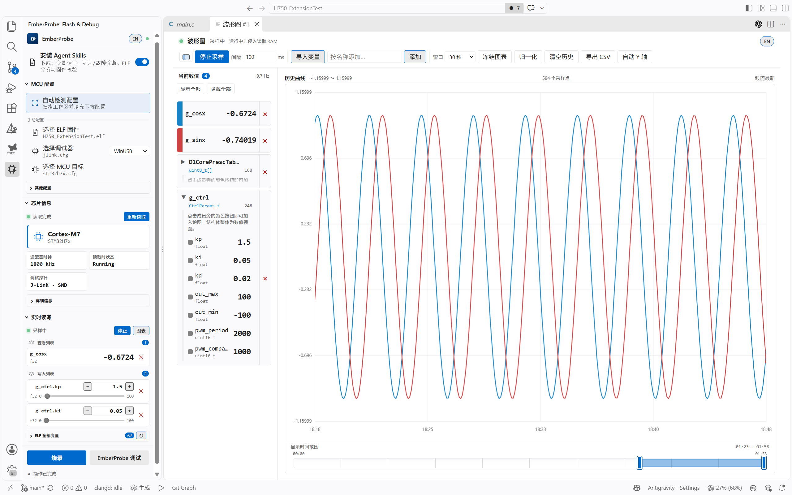
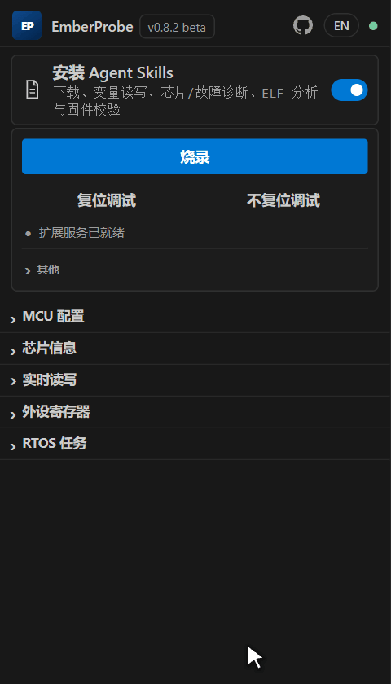
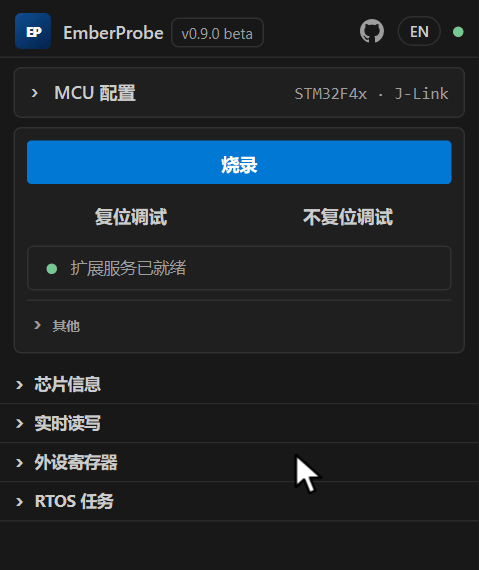
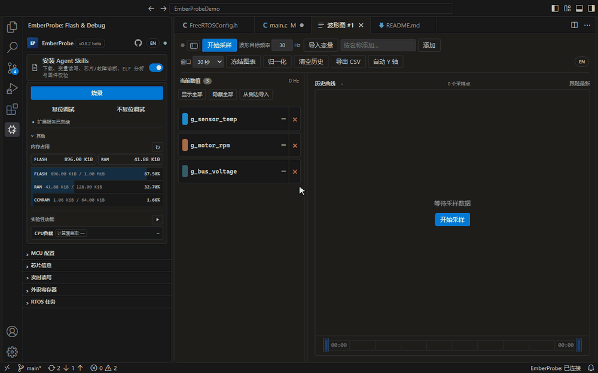
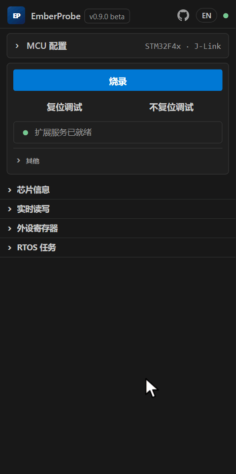
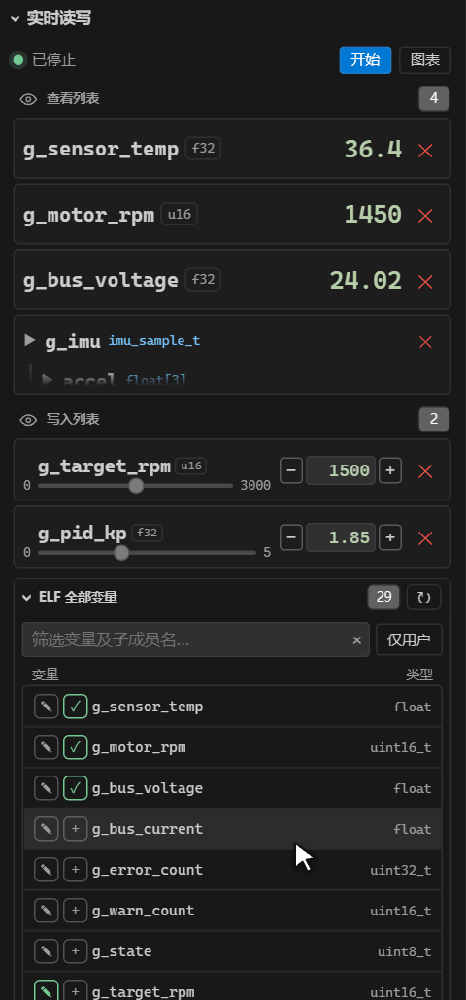
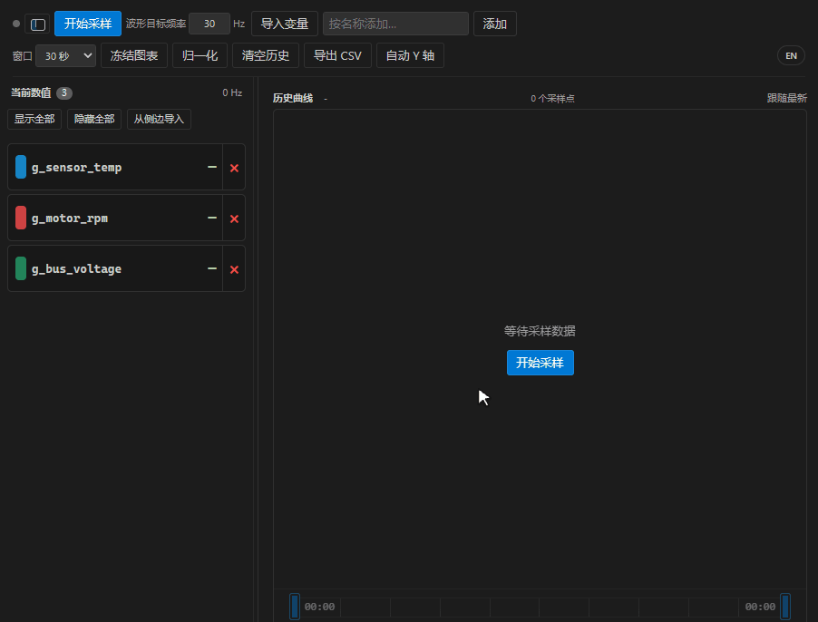
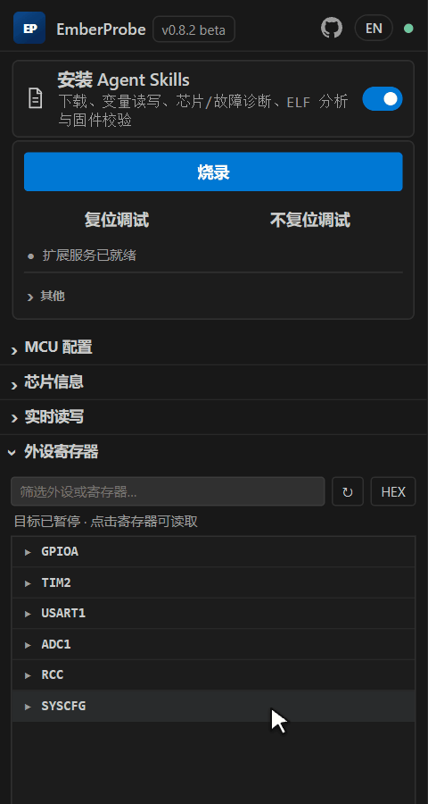
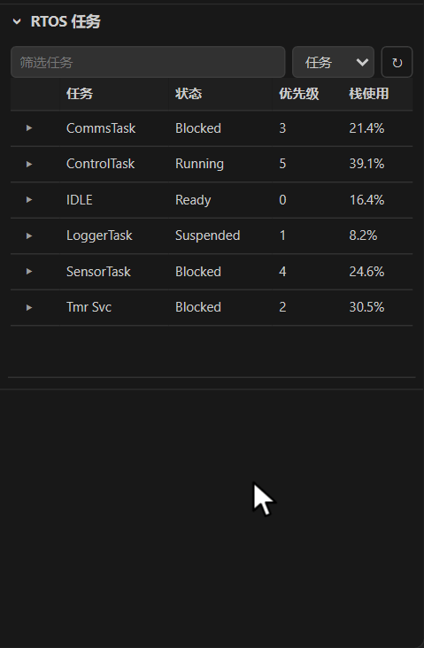

# EmberProbe

EmberProbe 是一款基于 OpenOCD 面向 Cortex-M 开发的 VS Code 扩展，集成固件烧录、断点调试、实时变量观测与 Agent 辅助开发。

> [English documentation](README_EN.md)



## 功能特性

- **自动识别**：检测工作区中最新的 ELF 文件与 MCU 目标。
- **固件烧录**：一键烧录 ELF 文件并运行，支持固件校验。
- **芯片信息**：查看芯片身份、存储容量与运行状态。
- **实时变量观测**：在目标运行时查看变量数值与波形，支持多图表、历史查看和 CSV 导出。
- **实时变量写入**：在目标运行时调整变量值，并自动回读校验。
- **内置断点调试**：支持断点、单步、调用栈、变量与寄存器查看，以及内存读写。
- **Agent 辅助开发**：提供可选安装的 Agent Skills，辅助完成固件开发、调试与分析。

## 环境要求

- Visual Studio Code 1.85 或更高版本
- OpenOCD 0.12.0 或更高版本
- ARM GDB 工具链（断点调试必需）

当前扩展版本为 `0.8.7`。

## 使用教程

| 章节 | 内容 |
| --- | --- |
| [一、配置与连接](#一配置与连接) | 一键配置、Debug 构建预设、手动配置、J-Link 配置、ARM 工具链 |
| [二、功能使用](#二功能使用) | 烧录、复位/不复位调试、芯片信息、实时读写、波形图、外设寄存器、RTOS 任务、内存占用 |
| [三、高级功能](#三高级功能) | RTOS 栈使用配置、调用栈任务感知、launch.json、探针与采样设置、C++ 显示、Agent Skills |
| [四、实验性功能](#四实验性功能) | 外部 GDB Server、不限速采样、CPU 负载估计、多核共享调试组 |
| [常见问题](#常见问题) | 变量读不到、探针被占用、J-Link 打不开等 |

### 一、配置与连接

#### 1. 一键配置

1. **准备 OpenOCD**：Windows x64 可在“OpenOCD 环境”卡片中一键离线安装；Linux x64 使用默认路径时会自动准备内置版本。其他平台或自定义版本可点击 **选择路径** 指定已安装的 OpenOCD，修改后点击 **重新检测**。
2. **自动检测配置**：展开“MCU 配置”，点击 **自动检测配置**，确认以下结果：
   - **ELF 固件**：工作区内最新的 `*.elf`；
   - **MCU 目标**：根据工程中的芯片型号匹配目标配置；
   - **调试器**：识别 ST-Link、CMSIS-DAP/DAPLink、J-Link 等探针，多台连接时按提示选择。
3. 检测结果有误时，在“手动配置”中调整。



#### 2. 注意：使用 Debug 预设构建

**请使用 Debug 预设构建固件**，保留变量、类型与源码调试信息。

Release 或去掉调试信息的 ELF 可能导致变量无法展开、局部变量显示 `optimized out`、RTOS 任务缺失等问题。重新编译后，确认选中正确的 ELF，并刷新变量列表。

#### 3. 单独配置（手动配置）

在“MCU 配置 → 手动配置”中选择：

| 配置项 | 说明 |
| --- | --- |
| ELF 固件 | 要烧录或观测的 `*.elf` |
| 调试器 | 与探针对应的配置，如 `stlink.cfg`、`cmsis-dap.cfg`、`jlink.cfg` |
| MCU 目标 | 与芯片对应的配置，如 `stm32f4x.cfg`、`stm32h7x.cfg` |

“其他配置”中的可选项：

| 配置项 | 说明 |
| --- | --- |
| SVD 文件 | 外设寄存器视图需要，可选择本地文件或 **下载官方 SVD**；下载前按提示确认来源许可 |
| CubeMX 路径 | 指定 STM32CubeMX，供 Agent 代码生成使用（Windows / Linux） |
| .ioc 路径 | 指定 CubeMX 工程；缺少固件包时可通过 **在 CubeMX 中安装** 补齐 |

配置按工作区保存。更多目标与探针说明见 [OpenOCD 目标配置](docs/OPENOCD-TARGETS.md)和[探针连接与选择](docs/PROBE-CONNECTIONS.md)。

#### 4. J-Link 配置

Windows 上，OpenOCD 使用 J-Link 需要 **WinUSB** 驱动；使用 SEGGER 工具时通常需要恢复 SEGGER 驱动。

1. 选择 `jlink.cfg`，或使用自动检测。
2. 出现驱动不匹配诊断时，在“选择调试器”旁的驱动下拉框选择 **WinUSB**，按提示完成 Windows 管理员授权。
3. 需要使用 J-Flash、Ozone 等工具时，在同一入口选择 **SEGGER** 恢复驱动。

先关闭占用探针的其他软件。不同 J-Link 硬件与固件的兼容性可能不同，详细要求见 [J-Link 兼容性说明](docs/JLINK-COMPATIBILITY.md)。

多台探针连接时按提示选择设备；指定的设备不在线时不会静默改用其他探针。序列号、协议与速度可在第三章“探针高级设置”中调整。

#### 5. ARM 工具链

烧录与独立实时采样只需要 OpenOCD；**断点调试**还需要 ARM GDB 工具链，可使用 [Arm GNU Toolchain](https://developer.arm.com/downloads/-/arm-gnu-toolchain-downloads)。

插件优先从 PATH 查找。首次调试找不到工具链时，按提示选择工具链根目录或 `bin` 目录；也可设置 `emberprobe.armToolchainPath` / `emberprobe.gdbPath`。

### 二、功能使用

#### 1. 烧录

点击 **烧录**，写入当前 ELF、校验并复位运行。状态行与日志显示进度，失败时展开“连接诊断”查看原因。

也可右键工程文件夹选择 **EmberProbe: 下载程序**，或从命令面板执行同名命令。



#### 2. 复位调试 / 不复位调试

| 按钮 | 行为 |
| --- | --- |
| **复位调试** | 下载当前固件，复位并运行到 `main` 停下 |
| **不复位调试** | 附加并暂停目标，**不复位、不下载固件**，保留当前现场 |

> 使用“不复位调试”时，选中的 ELF 必须与芯片中正在运行的固件一致。

进入调试后，使用 VS Code 原生界面：

- 继续/暂停、单步、重启与停止；
- 断点、条件断点、调用栈、监视表达式与调试控制台；
- 展开结构体、数组、枚举，以及 `std::vector`、`std::string` 等常见 STL 容器；
- 侧边栏实时读写、外设与 RTOS 面板跟随当前调试会话，暂停时查看快照。

工程文件夹右键菜单也提供这两个入口；自定义调试可使用 `launch.json`，见第三章。



#### 3. 芯片信息

展开“芯片信息”，点击 **读取 / 重新读取**：

| 内容 | 说明 |
| --- | --- |
| 芯片身份 | 内核、型号、容量、UID 与原厂校验等信息 |
| 连接信息 | 探针、协议、调试时钟与目标电压 |
| 运行状态 | 查看运行/暂停状态，可继续、暂停或复位运行 |
| 详细信息 | 展开查看芯片修订、设备标识、停止原因与暂停时的寄存器等 |

读取时需独占探针，请先停止冲突的采样、烧录或调试；复位后重新读取以刷新状态。



#### 4. 实时读写

在目标运行时查看 RAM 中的全局/静态变量，支持结构体、数组、C++ 类与常见 STL 容器的展开。



**写入列表**：添加可写变量后，先点击 **开始** 采样，再通过以下方式调整，写入后自动回读校验：

- 输入数值并按 Enter；
- 使用 `−` / `+` 步进按钮；
- 拖动滑块调整数值。

对齐的 32 位变量可保持 CPU 运行完成写入；其他宽度或未对齐变量需要短暂暂停，卡片会显示警告。调试运行中须先暂停才能写入这类变量。指针本身只读。

**ELF 全部变量**：

- 搜索变量名或成员名，点击 `+` 加入查看列表、`✎` 加入写入列表；
- **仅用户**隐藏常见驱动、RTOS 与库变量，悬停可查看来源；
- 重新编译后点击 **↻** 刷新；
- 同名静态变量按源文件区分，手动添加时可用 `main.c::g_cfg` 等限定名称。

数据指针可按需只读展开，收起后停止读取。局部变量请在暂停调试时通过变量视图查看。

**请使用与板上固件匹配的 ELF**，重新编译后确认已更新目标固件。Agent 会根据 EmberProbe 最近一次烧录记录提示差异，其他工具烧录不会更新该记录。

#### 5. 波形图

点击实时读写中的 **图表**，或执行 **EmberProbe: 实时变量查看**，打开波形窗口并添加变量。



**工具栏**

| 控件 | 作用 |
| --- | --- |
| 数值栏 | 查看当前值，可折叠或拖动分隔条调整宽度 |
| 采样频率 | 输入 0.1–200 Hz 或选择预设挡位；默认 30 Hz，实际频率受探针吞吐影响 |
| 冻结图表 / 恢复实时 | 冻结查看历史，后台继续采样；恢复后跟随最新数据 |
| 归一化 | 将不同量级的曲线缩放到相近高度，方便比较 |
| 清空历史 | 清空本窗口当前会话的历史 |
| 导出 CSV | 选择变量与时间范围，默认导出从开始采样或上次清空历史以来的原始采样点 |
| 自动 Y 轴 | 恢复纵轴自动缩放 |

**图表操作**

- 滚轮以鼠标位置为中心缩放：绘图区同时缩放两轴，坐标轴区域只缩放对应轴；
- 左键拖动平移两轴，中键拖动仅平移时间轴；
- 点击曲线冻结并查看该时刻读数，隐藏曲线不会停止采样；
- 拖动底部时间轴的高亮区域或两端，调整查看范围。

冻结不改变 CSV 导出范围。内存历史最多保留最近 30 分钟，实际范围受容量限制；完整采样另存临时磁盘归档，扩展退出后自动删除，需要保留的数据请先导出。容量设置见第三章。

#### 6. 外设寄存器

先在“其他配置”中选择或下载 **SVD 文件**，进入调试并**暂停芯片**后查看；目标运行时保留上次暂停时的数值。

| 操作 | 作用 |
| --- | --- |
| 展开外设、寄存器与位域 | 查看寄存器结构与数值 |
| ↻ / 点击寄存器名 | 刷新展开项或读取指定寄存器 |
| HEX / DEC / BIN | 切换显示格式 |
| `−` / `+` / 数值框 | 修改允许写入的寄存器或位域，写入后自动回读 |

读取有副作用的寄存器不会读取；只写或带特殊写入语义的寄存器不提供写入控件，可悬停查看限制原因。



#### 7. RTOS 任务

使用内置调试器，在 FreeRTOS 调度器启动后**暂停芯片**，查看任务快照：

- 任务名、状态、优先级与栈使用百分比；
- 按任务名筛选、按名称/优先级/状态排序，点击 **↻** 刷新；
- 展开任务查看栈范围、已用/剩余空间与运行计数器等详情，具体信息取决于固件配置。

停在 `main` 时调度器可能尚未启动，继续运行后再次暂停即可查看。目标继续运行后显示历史快照；栈使用配置见第三章。当前任务快照支持小端单核 Cortex-M 的 FreeRTOS。



#### 8. 内存占用

展开 **其他 → 内存占用**，查看 FLASH、RAM 及自定义区域的占用、容量和百分比，展开可看节明细与最大符号，点击 **↻** 重新分析。

容量来自工程的 `.map` 或链接脚本，有多个候选时按提示选择。统计反映链接占用，不代表运行时栈/堆峰值。

### 三、高级功能

#### 1. 配置 RTOS 栈使用查看

“栈使用”采用填充估算，反映任务栈的**历史峰值**，不是当前 SP。

在 `FreeRTOSConfig.h` 中保留栈顶地址，并开启栈填充，例如：

```c
#define configRECORD_STACK_HIGH_ADDRESS        1
#define configCHECK_FOR_STACK_OVERFLOW         2
```

栈填充也可由 `configUSE_TRACE_FACILITY` 或 `INCLUDE_uxTaskGetStackHighWaterMark` 启用，按工程需要选择。显示运行计数器还需 `configGENERATE_RUN_TIME_STATS` 与相应统计定时器。

使用 CubeMX 时，在 FreeRTOS 配置中调整对应选项，重新生成、以 Debug 预设构建并更新目标固件。缺少栈范围时栈使用显示不可用；更多要求见 [RTOS 感知调试](docs/RTOS-AWARENESS.md)。

#### 2. 调用栈中的 RTOS 任务

将 `emberprobe.rtos` 设为 `FreeRTOS`，重新启动调试后，调用栈可按任务列出，切换任务查看各自的栈帧与局部变量。

该设置默认关闭，名称区分大小写，也支持 OpenOCD 提供的其他 RTOS。固件需保留相关内核符号，配置与限制见 [RTOS 感知调试](docs/RTOS-AWARENESS.md)。

#### 3. 使用 launch.json 自定义调试

在 `.vscode/launch.json` 中添加 `emberprobe` 类型的配置，即可按 F5 启动，探针、目标与 OpenOCD 仍沿用侧边栏配置：

```json
{
  "version": "0.2.0",
  "configurations": [
    {
      "name": "EmberProbe: Launch",
      "type": "emberprobe",
      "request": "launch",
      "executable": "${workspaceFolder}/build/Debug/app.elf",
      "runToEntryPoint": "main",
      "rtos": "FreeRTOS"
    }
  ]
}
```

- `request` 为 `attach` 时等同于“不复位调试”；
- `runToEntryPoint` 指定启动后停下的函数；
- `rtos` 覆盖工作区设置，写 `""` 可在该会话关闭任务感知；
- 另支持 `preLaunchCommands` / `postLaunchCommands` / `preAttachCommands` / `postAttachCommands`（GDB 命令钩子）、`loadFiles`（下载多个镜像）、`symbolFiles`（附加符号文件）、`sourceFileMap`（源码路径映射）等字段，编辑时可借助 VS Code 自动补全查看全部字段。

#### 4. 探针高级设置

在 VS Code 设置中搜索 `emberprobe`：

| 设置 | 说明 |
| --- | --- |
| `emberprobe.probeSerial` | 指定探针序列号，多探针时固定设备 |
| `emberprobe.transport` | 选择 `auto`（默认）、`swd` 或 `jtag` |
| `emberprobe.adapterSpeedKhz` | 调试时钟，`0` 使用脚本默认值；连接不稳定时可降低 |
| `emberprobe.openocdPath` | 指定 OpenOCD 可执行文件 |
| `emberprobe.tclPort` | 采样连接端口，默认自动分配，一般无需修改 |

详细连接规则见 [探针连接与选择](docs/PROBE-CONNECTIONS.md)。

#### 5. 采样频率与历史容量

| 设置 | 默认值 | 说明 |
| --- | --- | --- |
| `emberprobe.sampleFrequencyHz` | 30 | 波形目标频率；侧边栏目标为 20 Hz |
| `emberprobe.chartHistoryMaxMiB` | 512 | 内存历史预算；不足时缩短历史或产生缺口，磁盘归档继续 |
| `emberprobe.samplingArchiveMaxMiB` | 1024 | 临时磁盘归档上限，扩展退出后删除 |

隐藏曲线仍会采样和记录。磁盘归档达到上限或写入失败时会暂停采样。详细规则见 [实时变量采样说明](docs/LAYERED-SAMPLING.md)。

#### 6. 内存区域类型

若链接脚本中有自定义区域名（如 `APP_STORAGE`、`FAST_HEAP`），可通过 `emberprobe.memory.regionKinds` 指定类型：

```json
{
  "emberprobe.memory.regionKinds": { "APP_STORAGE": "flash", "FAST_HEAP": "ram" }
}
```

#### 7. C++ 变量显示

支持 C++ 类与常见 STL 容器的语义展开，默认隐藏编译器与标准库内部成员，每个变量可切换“显示原始成员”。指针显示目标名称，支持按需只读展开，见 [指针显示](docs/POINTER-DISPLAY.md)。

暂停调试时，`emberprobe.prettyPrintingMode` 可选 `builtin`（默认，内置显示）、`gdb`（加载 `emberprobe.prettyPrinterFiles` 指定的 Python 脚本）或 `raw`（原始成员）。

#### 8. Agent Skills 与 CubeMX 代码生成

通过侧边栏顶部 **安装 Agent Skills**，选择安装到当前项目、全局安装或卸载。安装后，兼容的 AI 编程助手可协助烧录、变量读写、调试与分析，能力列表见下方 [Agent Skills](#agent-skills)。

烧录、变量/外设写入、CubeMX 生成等操作由 Agent 先展示计划，在对话中确认后执行。烧录、变量写入与 CubeMX 生成在满足条件且明确选择后可记住许可，最长 24 小时；Flash 校验与外设写入逐次确认。见 [Agent 信任边界](docs/AGENT-TRUST-BOUNDARIES.md)。

CubeMX 生成支持 Windows/Linux：配置 CubeMX 与 `.ioc` 路径后，先在隔离副本中生成、比对，保留 `USER CODE` 后写回。见 [CubeMX 代码生成说明](docs/CUBEMX-GENERATION.md)。

### 四、实验性功能

以下功能默认关闭或标记为实验性，尚未完成全部实板验收，行为可能调整。

#### 1. 外部 GDB Server

可用内置调试器附加到已启动的 J-Link GDB Server、pyOCD 或 ST-LINK GDB Server。

在工作区设置启用 `emberprobe.experimental.externalGdb.enabled`，配置服务器地址，再通过 `launch.json` 的外部 attach 配置启动。完整示例见 [外部 GDB Server](docs/EXTERNAL-GDB-SERVER.md)。

支持断点、单步、变量与暂停时内存访问，不支持下载、复位、重启及运行期采样。结束后需自行停止服务器，并关闭实验开关以解除探针占用保护。

#### 2. 不限速采样

开启 `emberprobe.experimental.unlimitedSampling.enabled` 后，采样频率的下拉滑条增加 **不限速** 挡位。

仅独立采样生效，调试会话仍使用有限目标频率；实际速率取决于探针吞吐与宿主处理能力。高频会缩短可回看的内存历史，并加快磁盘归档消耗，见 [不限速采样](docs/UNLIMITED-SAMPLING.md)。

#### 3. CPU 负载估计

适用于 ELF 带内核调试信息的单核 FreeRTOS 工程，无需修改固件。在 **其他 → 实验性功能** 中开始采样，查看负载估计与覆盖率；覆盖率不足时不显示负载值。

CPU 采样独占探针，与烧录、调试及变量采样互斥。支持范围与限制见 [CPU 负载估计](docs/CPU-LOAD-MONITORING.md)。

#### 4. 多核共享调试组

双核芯片可在 `launch.json` 中通过 `serverGroup`、`numberOfProcessors`、`targetProcessor` 让多个调试会话共用一个 OpenOCD 与探针：先启动一个核，初始化成功后再 attach 其他核。配置示例见 [多核共享 OpenOCD](docs/SHARED-DEBUG-GROUPS.md)。

### 常见问题

| 现象 | 处理 |
| --- | --- |
| 变量类型显示为推测、成员无法展开、`optimized out` | 使用 Debug 预设重新构建，确认选中的是 Debug 目录下的 ELF，然后点击 ELF 全部变量的 **↻** |
| 提示探针被占用 / 无法同时进行 | 同一探针同一时刻只能被一个 OpenOCD 使用：先停止实时采样、CPU 采样或调试，或关闭 Ozone、CubeIDE 等其他占用探针的软件 |
| J-Link `Failed to open device` | 按第一章第 4 节切换到 WinUSB 驱动，并确认没有其他软件占用 |
| 读取芯片信息超时 / 目标电压异常 | 检查 SWD 接线、目标供电与 VTref；可在设置中降低 `emberprobe.adapterSpeedKhz` |
| 外设寄存器无数值 | 需要配置 SVD，并在调试会话中暂停芯片 |
| RTOS 任务为空 | 停在 `main` 时调度器尚未启动，继续运行后再暂停；确认使用 Debug 构建且内核符号未被裁剪 |
| 调试启动超时 | 检查 GDB 是否能在终端正常启动，或在设置中指定 `emberprobe.gdbPath` |

## Agent Skills

| 重点功能 | Skill |
| --- | --- |
| 固件烧录与变量读写 | `mcu-flash`、`mcu-variables` |
| 芯片信息与故障分析 | `mcu-chip-info`、`mcu-fault-analyzer` |
| ELF 与外设分析 | `mcu-elf-analyze`、`mcu-peripheral-debug` |
| 断点与 FreeRTOS 调试 | `mcu-debug-control`、`mcu-rtos` |
| 配置管理与 CubeMX 代码生成 | `mcu-config`、`mcu-cubemx` |

## 更多文档

- [更新记录](CHANGELOG.md)
- [Agent Skills](skills/)
- [实时变量采样说明](docs/LAYERED-SAMPLING.md)
- [FreeRTOS 调试说明](docs/RTOS-AWARENESS.md)
- [J-Link 兼容性说明](docs/JLINK-COMPATIBILITY.md)
- [枚举变量显示](docs/ENUM-VARIABLES.md)
- [ELF 变量来源筛选](docs/VARIABLE-ORIGIN-FILTER.md)
- [外部 GDB Server（实验性）](docs/EXTERNAL-GDB-SERVER.md)
- [不限速采样（实验性）](docs/UNLIMITED-SAMPLING.md)
- [CPU 负载估计（实验性）](docs/CPU-LOAD-MONITORING.md)
- [多核共享调试组（实验性）](docs/SHARED-DEBUG-GROUPS.md)
- [CubeMX 代码生成说明](docs/CUBEMX-GENERATION.md)
- [Agent 信任边界](docs/AGENT-TRUST-BOUNDARIES.md)
- [发布指南](docs/RELEASING.md)

## 许可证与归属

扩展代码采用 MIT 许可证。npm 运行时依赖与自带 xPack OpenOCD 的许可证及来源信息见 [THIRD_PARTY_NOTICES.md](THIRD_PARTY_NOTICES.md)。
