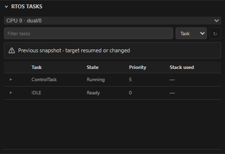

# Native GDB console / 原生 GDB 控制台

在原生 `emberprobe` 调试会话中，VS Code **调试控制台**的每次输入都是一条 GDB CLI 命令：

| 输入 | 用途 |
| --- | --- |
| `bt` | 查看调用栈 |
| `info registers` | 查看寄存器 |
| `p counter` | 打印变量；直接输入 `counter` 不再求值 |
| `x/16wx 0x20000000` | 按 32 位十六进制查看 16 个内存单元 |
| `set variable counter = 5` | 修改变量 |
| `thread 2`、`frame 1` | 切换 GDB 当前线程、栈帧 |
| `continue`、`next`、`step`、`finish` | 运行或单步 |
| `info breakpoints` | 查看 GDB 中的全部断点及实际启用状态 |

Watch 与悬停仍使用表达式，例如 `counter`。此行为只作用于原生 EmberProbe 会话；Cortex-Debug 的控制台行为由该扩展决定。

输入经现有 GDB/MI 通道串行执行，输出直接显示在控制台。支持单行命令，长度最多 16,384 个字符；拒绝空白输入、换行和 NUL。引号、反斜杠与中文保留。没有原始 MI 输入模式，也没有多轮交互输入；初始化关闭分页和确认提示。需要定义多行命令时，可在外部文件中准备脚本，再使用单行 `source` 命令。

目标运行时也可提交命令，能否执行由 GDB 判断；EmberProbe 不为控制台命令自动暂停或恢复。普通 GDB 命令错误显示在控制台，会话继续可用。超时、传输关闭及 GDB 退出沿用会话清理流程，不自动重试命令。

每次命令会使旧栈帧、变量、Agent 检查句柄、侧栏暂停快照及 RTOS 结果失效。若请求带有有效栈帧，先选择该线程与栈帧；无栈帧时保留当前 GDB 上下文。命令执行后的线程／栈帧选择用于后续无栈帧表达式求值。执行期间暂停相关后台读取、写入和会话切换，仍可停止调试；完成后按真实暂停／运行状态重新读取数据。共享组按会话隔离忙状态与数据，控制台顶部的调试会话选择决定命令发往哪个核；侧栏会话选择负责侧栏和 Agent 路由。目标脚本或显式命令的芯片级副作用仍可能影响其他核。

通过控制台 `break` 创建的断点由 GDB 管理，不自动导入 VS Code。对已经映射的 VS Code 断点，GDB 修改／删除通知及暂停后的断点列表用于同步地址、行号、验证和删除状态；运行中未能校准时延迟至下一次停止。删除后废弃旧 GDB 编号，后续设置断点会重新创建。

GDB 的 `enable`／`disable` 无法直接映射到 VS Code 的断点勾选状态。禁用时断点消息会说明差异；以 `info breakpoints` 为准。通过 VS Code 再次编辑断点可能重新创建或改变该断点。

本功能不增加 Agent 任意 GDB 命令接口，不改变 Agent 写入、烧录及 CubeMX 授权。

## English

Every Debug Console input in a native `emberprobe` session is a single GDB CLI command. Use `p counter` to print a value; Watch and hover still evaluate expressions. Commands reuse the serialized MI channel and its output stream. Quotes, backslashes and Unicode are preserved. Blank input, line breaks, NUL and input longer than 16,384 characters are rejected. Raw MI and interactive follow-up input are unavailable; pagination and confirmation are disabled at startup.

Commands may be submitted while running; GDB decides whether they can execute. There is no automatic interrupt/resume. GDB errors leave the session usable; timeout, transport closure and exit use normal cleanup without retry. Commands invalidate old DAP/Agent handles and sidebar/RTOS snapshots. A valid supplied frame selects the initial context; otherwise GDB's current context is retained. Background inspection, writes and session selection wait for completion, while Stop remains available. Running/stopped events remain authoritative, including a stop arriving before the command response. Each core retains its own busy state and data.

CLI-created breakpoints remain GDB-owned. Existing VS Code mappings follow GDB modification/deletion notifications and paused list reconciliation, without retaining deleted GDB IDs. DAP can report locations, verification and removal, but cannot change the VS Code enable checkbox to match GDB `enable`/`disable`; consult the breakpoint message and `info breakpoints`.

## Verification / 验证

模拟 REPL 忙状态：会话选择与 RTOS 刷新禁用，旧任务快照标为过期。Simulated REPL busy state: session selection and refresh are disabled, and the previous task snapshot is stale.

`test/debug-console.test.js` covers forwarding, validation, state races, invalidation, breakpoint reconciliation and Bridge isolation. `test/e2e/suite/debug.test.js` uses the actual adapter with a subprocess simulated GDB. `test/gdb/cpp-paused.test.js` and `test/gdb/external-debug.test.js` exercise real GDB, respectively against a native program and a memory-only ARM RSP server. Normal tests and these simulated targets do not establish board compatibility. No hardware operations are required for these tests.
