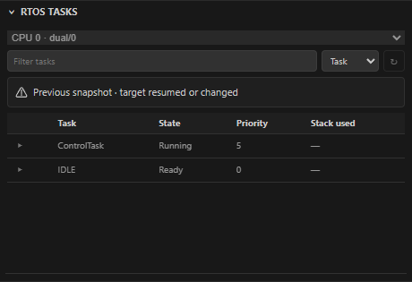

# 调试会话设计

用户行为见 [GDB 控制台](../guide/flash-debug.md#gdb-控制台)、[RTOS 调试](../guide/flash-debug.md#rtos-调试)、[多核调试](../guide/flash-debug.md#多核调试)和[外部 GDB Server](../guide/flash-debug.md#外部-gdb-server)。

## GDB 控制台

输入经现有 GDB/MI 通道串行执行，输出直接显示在控制台。支持单行命令，长度最多 16,384 个字符；拒绝空白输入、换行和 NUL。引号、反斜杠与中文保留。没有原始 MI 输入模式，也没有多轮交互输入；初始化关闭分页和确认提示。需要定义多行命令时，可在外部文件中准备脚本，再使用单行 `source` 命令。

目标运行时也可提交命令，能否执行由 GDB 判断；EmberProbe 不为控制台命令自动暂停或恢复。普通 GDB 命令错误显示在控制台，会话继续可用。超时、传输关闭及 GDB 退出沿用会话清理流程，不自动重试命令。

每次命令会使旧栈帧、变量、Agent 检查句柄、侧栏暂停快照及 RTOS 结果失效。若请求带有有效栈帧，先选择该线程与栈帧；无栈帧时保留当前 GDB 上下文。命令执行后的线程／栈帧选择用于后续无栈帧表达式求值。执行期间暂停相关后台读取、写入和会话切换，仍可停止调试；完成后按真实暂停／运行状态重新读取数据。共享组按会话隔离忙状态与数据，控制台顶部的调试会话选择决定命令发往哪个核；侧栏会话选择负责侧栏和 Agent 路由。目标脚本或显式命令的芯片级副作用仍可能影响其他核。

通过控制台 `break` 创建的断点由 GDB 管理，不自动导入 VS Code。对已经映射的 VS Code 断点，GDB 修改／删除通知及暂停后的断点列表用于同步地址、行号、验证和删除状态；运行中未能校准时延迟至下一次停止。删除后废弃旧 GDB 编号，后续设置断点会重新创建。

GDB 的 `enable`／`disable` 无法直接映射到 VS Code 的断点勾选状态。禁用时断点消息会说明差异；以 `info breakpoints` 为准。通过 VS Code 再次编辑断点可能重新创建或改变该断点。

本功能不增加 Agent 任意 GDB 命令接口，不改变 Agent 写入、烧录及 CubeMX 授权。

运行/停止事件始终是权威状态，包括先于命令响应到达的停止事件。

模拟 REPL 忙状态：会话选择与 RTOS 刷新禁用，旧任务快照标为过期。



`test/debug-console.test.js` 覆盖转发、校验、状态竞争、失效、断点校准和 Bridge 隔离。`test/e2e/suite/debug.test.js` 用子进程模拟 GDB 驱动真实适配器。`test/gdb/cpp-paused.test.js` 和 `test/gdb/external-debug.test.js` 分别对原生程序和仅内存的 ARM RSP 服务器运行真实 GDB。这些测试不需要硬件，也不证明板卡兼容性。

## 数据断点

`src/debug/dataBreakpoints.js` 实现 DAP `dataBreakpointInfo` / `setDataBreakpoints`，适配器声明 `supportsDataBreakpoints`。`dataBreakpointGroups` 分别持有 VS Code 和侧边栏的监视点管理器，标准 DAP 整批替换仅作用于 VS Code 集合；内部 `emberprobe.sidebarDataBreakpoints` 请求管理侧边栏集合，两者共享会话请求队列、硬件资源与执行安全检查，不互相删除。命中按 GDB 编号路由到所属管理器。

侧边栏服务由 composition 构造，消息走侧边栏路由，菜单和状态保存在页面 state。内部请求支持 list/info/add/enable/condition/remove，以及保存查看列表前使用的 removeNames；`emberprobe.sidebarDataBreakpointsChanged` 事件发布逻辑 ID、固定存储描述和验证状态。逻辑 ID 在启停与条件修改时保持稳定，硬件编号可以变化。除 removeNames 外的修改要求暂停，绑定所选会话、停止与检查代次及 ELF 代次；适配器再次验证执行和变量代次。查询复用 GDB 的无副作用路径校验，侧栏先根据当前 ELF 归一化变量，拒绝合成的运行时路径，不接受 Webview 地址。

运行中的菜单操作显式暂停目标，查询后保持暂停，不自动恢复。移除查看列表项前清理它及所移除子项的侧栏断点：removeNames 按名称匹配、不需要代次，也不显式暂停，运行中由整批更新内部中断并自动继续（与 VS Code 原生移除相同），因此 Agent 的 watch_remove 不会停下目标。清理失败保留断点记录并恢复查看列表。任何更新失败后，条目按 GDB 仍持有的监视点重新对齐，不会留下没有对应行的硬件监视点。服务对适配器的请求按到达顺序排队执行，条件输入框在入队前完成，不阻塞其他请求。Webview 重建重新查询适配器；调试结束后清空，禁用断点保留固定存储身份。VS Code 没有公开的数据断点创建 API，因此本次不向其断点列表镜像侧栏断点，也不使用依赖系统变量视图隐藏上下文的内置添加命令。两处断点可以共存，但可能各自消耗硬件监视资源。

信息查询使用当前停止代次的变量容器、成员映射和真实节点身份，复用变量元数据及线程／栈帧绑定；表达式查询限制为无副作用的可寻址路径。仅发布已确认地址、自然对齐且宽度为 1/2/4 字节的存储身份。会话内不透明 ID 有数量上限，`canPersist: false`；带变量／栈帧引用但尚未激活的 ID 在继续执行后失效。已激活的监视点绑定固定地址，可跨停止代次启停，不追踪局部变量寿命、容器搬迁或指针重定向。

监视点经 `-break-watch` 建立，写入、读取和访问分别对应默认、`-r`、`-a`。固定地址使用匹配宽度的基础整数解引用，不在继续运行时重新求值原始路径。创建响应或 `-break-info` 必须确认硬件类型；发现软件监视点时立即清理，清理未确认则阻止适配器继续执行。硬件资源在下一次继续时才报告不足的情况，经现有执行错误路径标记断点失败。

替换请求只管理本模块持有的 GDB 编号，不删除源码断点或用户控制台建立的其他监视点。运行中设置复用现有内部中断流程，只在 SIGINT 确认为内部暂停时自动恢复，真实断点命中保持停止。MI 监视点停止原因映射为 DAP `data breakpoint`，附带拥有的 DAP 断点编号及 GDB 提供的旧值／新值；控制台修改与删除通过异步记录及停止后的 `-break-list` 校准。

`test/data-breakpoints.test.js` 覆盖信息查询、身份与时序、硬件限制、替换、错误清理及命中事件；Extension Host 测试通过真实 DAP 验证设置、命中与删除。`test/gdb/data-breakpoints.test.js` 使用真实 ARM GDB 和内存 RSP 目标，验证 GDB/MI 与远程监视点包，不执行真实 MCU 指令，也不证明板卡兼容性。

## RTOS 感知

### 取值

可接受取值为 `auto`、`none`、`FreeRTOS`、`ThreadX`、`chibios`、`Chromium-EC`、`eCos`、`embKernel`、`linux`、`mqx`、`nuttx`、`RIOT`、`uCOS-III`、`Zephyr`。OpenOCD 区分大小写，因此 `freertos`、`FreeRTOs` 会在接触任何硬件之前以 `OPENOCD_RTOS_INVALID` 被拒绝。该列表取自 Cortex-Debug 为 OpenOCD 记录的名称，另加 `none`；内置 OpenOCD 虽也编译了 `hwthread` 与 `rtkernel`，但刻意不开放——`hwthread` 只报告一个无名线程，`rtkernel` 仅用于 RTEMS。

`none` 与留空不同：留空表示 EmberProbe 完全不发 `-rtos`；`none` 则是显式告知 OpenOCD，可覆盖 target `.cfg` 中已有的 `-rtos` 设置。

### 生效位置

仅调试模式。EmberProbe 在接口与 target 配置文件之后、**`init` 之前**插入一条 `-c` 命令，为当前 target 配置 RTOS：

```tcl
set _ep_rtos_target ""; catch { set _ep_rtos_target [target current] };
if { $_ep_rtos_target eq "" } { error "EmberProbe: no current target to configure for RTOS <name>" };
_ep_rtos_target configure -rtos <name>
```

若不存在当前 target，或 OpenOCD 拒绝该名称，这里会抛出 Tcl 错误，OpenOCD **在打开探针之前**非零退出，随后由既有的启动清理流程报出带建议动作的 `OPENOCD_RTOS_INVALID`。双核器件只配置当前 target，因此请选择真正运行 RTOS 的那个核。独立实时采样永不配置 RTOS：遍历内核数据结构会改变非侵入轮询行为。该取值在 OpenOCD 启动时读取，因此改动在下次启动调试时生效。适配器的 `restart` 刻意复用正在运行的 OpenOCD 服务（服务由扩展而非适配器持有），因此“重启”仍保持先前配置的 RTOS；需停止后重新启动才会应用改动。

### 任务与线程绑定

开启感知后，适配器维护一个"GDB 真正确认过"的任务 ID 集合：attach 后由 `-thread-info` 播种，之后由 `=thread-created` / `=thread-exited` 维护。它绝不上报未确认的 ID——没有已确认任务时，`stopped` 事件直接不带 `threadId`，由 VS Code 依据任务列表刷新调用栈。因此在调度器建立任务之前、或刚复位之后，看到的是一个已确认线程，而不是一组臆造的 ID。

栈帧、局部变量与表达式求值都绑定到所属任务与栈帧（`-var-create --thread N --frame M`），`continue` / `next` / `stepIn` / `stepOut` 则钉住被请求的任务（`-exec-next --thread N`）。因此浏览另一个任务的栈不会导致随后的单步作用在你正在看的那个任务上。请求一个已退出的任务会返回 `DEBUG_TASK_EXITED`，而不是去单步别的任务；ID 非法则返回 `DEBUG_THREAD_INVALID`。Watch／悬停继续使用表达式；原生调试控制台接受 `p counter`、`thread 2`、`frame 1` 等 GDB CLI 命令，无栈帧参数时保留当前 GDB 上下文。命令使旧检查句柄和 RTOS 快照失效，执行期间阻止后台检查、写入和会话切换，完成后按真实运行／暂停状态刷新。详见上文 GDB 控制台一节。

侧栏与 Agent 的调试控制在操作已暂停的 RTOS 会话前，会用实时任务列表校准缓存的任务 ID，并优先选择真正停下的那个任务。非 RTOS 会话保持原有的零往返路径。

### FreeRTOS 任务快照

FreeRTOS 任务面板仅做有界暂停读取，支持过滤、排序和运行后旧快照标记。可选栈填充估算必须先确认边界与布局，不代表实时 SP。浏览某任务栈时它被删除，会在下一次控制操作时以 `DEBUG_TASK_EXITED` 显现。崩溃任务分析仍未实现。

任务快照要求小端 ARM32 和单核 FreeRTOS 内核。GDB 有时把 Cortex-M 的 ELF/AXF 报告为通用 `arm` 或 `armv6`/`armv7`/`armv8`，固件缺少 `.ARM.attributes` 的 `Tag_CPU_arch` 时则显示默认的 `armv3m`。架构名不带 A/R 后缀就不能确定内核，此时面板依据 [GDB 的 M-profile 寄存器描述](https://sourceware.org/gdb/current/onlinedocs/gdb.html/ARM-Features.html)，检查当前会话的寄存器名称是否包含 `xpsr` 且不含 `cpsr`。该查询只读取元数据，不读取寄存器值或修改目标架构。明确的 A/R 架构、无法确认的目标、大端、非 32 位指针和 FreeRTOS SMP 仍不支持。拒绝时会在诊断中列出 GDB 的架构、字节序和指针大小；不会用侧栏的芯片信息代替当前调试会话的确认结果。

首次自动停在 `main` 通常早于任务创建和调度器启动。任务数与当前 TCB 确认尚无任务时，面板显示启动提示，不遍历仍为零值的链表；继续运行过初始化，再暂停查看任务。`pxEndOfStack`、`ulRunTimeCounter` 是否存在取决于固件配置，缺失时省略对应统计；已经初始化的链表损坏或内存读取失败仍显示部分结果。

首次暂停之后的快照开销：目标架构检查与 TCB、链表的类型布局只取自 GDB 的目标元数据与符号信息，会缓存到符号目录重新加载为止；布局查询若因配置缺字段以外的原因失败，下次暂停会重新查询。此后每次暂停只求值 `pxCurrentTCB`、`xSchedulerRunning`、`uxCurrentNumberOfTasks`，把相邻的内核链表头（就绪数组、延时链表指针及链表、挂起、待就绪与待删除链表）合并为一次不超过 4 KiB 的读取，并用一次读取同时取回 TCB 及其内嵌的链表项。链表头不相邻或整块读取失败时退回逐个读取。栈填充扫描不变。

首次自动停在 `main` 时，若 `xSchedulerRunning` 或任务数确认当前 TCB 为空，面板显示启动提示；两个内核静态变量都被优化掉时无法区分这两种情况，面板报告状态无法确定，而不是猜测。

### 验证边界

配置处理、OpenOCD 参数顺序、多任务 GDB/MI 事件与 DAP 控制由不依赖硬件的测试覆盖（`test/ember-debug.test.js`、`test/openocd-entrypoints.test.js`、`test/openocd-compatibility.test.js`、`test/debug-control.test.js`）。真正的任务发现取决于板子、内核构建与链接脚本，因此按 `test/hil/README.md` 中的 FreeRTOS 手工流程在专用硬件上验证。自动化测试套件不能证明这部分结果。

## 共享 OpenOCD 组

`serverGroup` 允许 1–64 个字母、数字、下划线、点和短横线，以字母或数字开头；核数须为 2–32。`targetProcessor` 为从零开始的索引；可选 `targetName` 必须与该索引的实际目标名一致。启动时为每个目标配置独立 GDB 端口，选定当前目标，向组内所有目标配置同一个 RTOS，再初始化 OpenOCD。依据 [OpenOCD target 配置](https://openocd.org/doc/html/CPU-Configuration.html) 与 [server 配置](https://openocd.org/doc/html/Server-Configuration.html)；目标脚本决定芯片级复位行为。

组内成员须共享实际工作区、OpenOCD 路径、探针、目标脚本、传输方式、序列号、速度、核数与 RTOS 设置。各核可以有独立 ELF、symbolFiles 和 primary RTOS 符号镜像。当前每个扩展 provider 管理一个物理组；不同组不会绕过探针独占。不同核使用不同 RTOS 的组合尚不支持。

每个会话独立保留运行／暂停状态、DAP 能力和停止任务；未选中核的事件不能改变所选核。切换核增加停止代次，废弃旧变量及 RTOS 读取结果并清空任务表；写入与执行控制期间不可切换。写入授权绑定所选 DAP session 身份。侧栏仍使用用户选定 ELF 的 DWARF 地址，读取／写入前必须与当前核 executable 一致；选择对应 ELF 后重试。RTOS 快照直接使用当前适配器的主镜像。

停止一个核不会停止同组其他成员。最后一个成员退出时停止 OpenOCD，确认进程退出后再释放唯一探针租约；退出未确认则保留租约和服务器引用。启动失败与超时只清理该成员；服务器提前退出会终止所有成员。共享组不支持 restart，请先结束所有会话后重新 launch。多目标运行期 Tcl 采样关闭，暂停读取通过所选 DAP；不承诺跨核同步单步或 SMP 一致快照。用户显式 GDB hooks 按配置执行，其芯片级副作用仍由用户命令和目标脚本决定。

外设无 halt 访问的首版仅覆盖单核托管 OpenOCD。共享组继续使用所选会话的暂停 DAP 访问，
运行中不创建第二个 OpenOCD，也不默认访问首核。详见 [外设访问设计](peripheral-access.md)。

普通测试覆盖核数／名称／端口、RTOS 参数顺序、加入失败、超时、退出确认与租约保留、多会话暂停／控制隔离、工作区选择、旧结果失效、CLI、ELF 匹配和 RTOS 下拉框。侧栏使用模拟快照检查 320／420 像素预览。测试不连接真实探针，也不证明双核板卡兼容。

专用双核硬件验收需记录 OS、OpenOCD／GDB、目标脚本、两核固件和 RTOS 版本，确认两核分别暂停／恢复／停止、任务表所属核、首核 launch 的芯片复位行为、失败恢复，以及末成员退出后探针可重新独占。遵循 [HIL 指南](../../test/hil/README.md)，现有只读 H750 不用于下载、复位或写入验证。

## 外部 GDB 服务器

连接会确认目标停止状态；仍在运行时尝试中断并等待停止。暂停侧栏与 Agent 读写使用选定 DAP 会话，侧栏地址读取和变量写入要求选定 ELF 与会话 ELF 一致，写入保留现有授权及读回验证。服务器地址与模式只能在原生设置中配置并在启动时冻结；launch.json 不能提供 `gdbTarget`、`serverpath`、`serverGroup` 或 OpenOCD 选核参数。

停止调试时插件尝试断开 target 连接并退出本地 GDB，不发送 detach、目标 kill 或 monitor exit。

外部连接尝试后会保存占用保护标记。断开、连接失败或扩展重载不会自动解除；保护期间阻止本插件竞争探针的硬件操作与驱动切换。仅开启设置但未尝试外部连接，不阻止原有功能。关闭开关不强行终止活动会话；若本地 GDB 退出未确认，保护继续保留。异常 adapter 退出后可在确认本地 GDB 已退出后重载工作区，插件检查已记录进程是否仍存活；未能记录进程身份时保守保留保护。

保护仅约束当前扩展实例，不能阻止其他应用或 VS Code 窗口使用同一探针。TCP 可达与否不代表物理探针已释放。

普通测试覆盖原生设置、隔离编排、占用持久化、线程绑定、ELF 检查、写入身份及退出清理。`test/gdb/external-debug.test.js` 使用真实 ARM GDB 与内存 RSP fixture，验证两种连接模式、暂停读写、断开与同服务器重连；fixture 不连接硬件，拒绝 monitor 命令。Extension Host 测试覆盖 F5 attach、能力更新、Stop 和关闭开关解除保护。

这些测试不证明 J-Link、ST-LINK、pyOCD 等具体服务器或板卡的兼容性。实板验收须单独记录 OS、GDB/server 版本、探针、板卡、固件与停止后的目标状态，并遵循 HIL 授权要求。
